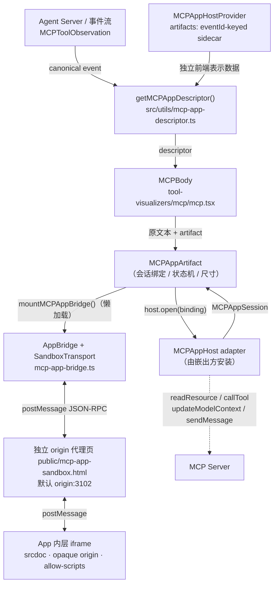

# MCP Apps in Agent Canvas

Agent Canvas 作为 **host**，把 MCP server 通过工具结果返回的交互式 UI（`ui://…`）
渲染成对话流里的内联 artifact。工具原有的文本结果照旧渲染，App 是叠加在其上的
渐进增强。

对应 issue：[OpenHands/OpenHands#16620][issue]。
本增量是**前端集成骨架 + 自包含 HTML host**：Agent Server 1.54.0 尚未提供生产所需的
resource / tool 代理，所以默认 Canvas **不装配 adapter**，行为与今天完全一致——
没有新的 wire 字段、没有版本下限、没有新的 Agent Server endpoint。

> 规格细节与验收条目见 [`specs/mcp-apps.md`](../../../../specs/mcp-apps.md)。
> 本文件只讲架构：分层、数据流、契约边界、安全模型与本地验证方式。

---

## 1. 数据流



四个阶段各自独立、可分别替换：

1. **识别**：Provider 独立拥有的 sidecar 中有没有该事件的 UI 声明？
2. **取回**：adapter 从正确的 server 取 `ui://` 资源与工具结果。
3. **桥接**：官方 `AppBridge` 完成握手与数据投递，见 §5。
4. **隔离**：独立 origin 的双层 iframe 承载不可信 HTML，见 §6。

---

## 2. 文件地图

| 路径                                                        | 职责                                                                                                                                 |
| ----------------------------------------------------------- | ------------------------------------------------------------------------------------------------------------------------------------ |
| `src/types/mcp-app.ts`                                      | 全部对外类型契约：`MCPAppIntegrationData` / `Artifacts` / `Descriptor` / `Binding` / `Scope` / `Session` / `Host` / `RequestOptions` |
| `src/utils/mcp-app-descriptor.ts`                           | 验证 canonical MCP event 与独立的 sidecar 数据，含 `_meta.ui.resourceUri` 解析与轻量校验；忽略事件上未发布的 App 字段                |
| `src/components/features/chat/tool-visualizers/mcp/mcp.tsx` | 工具可视化器：原文本 markdown + App artifact                                                                                         |
| `src/components/features/mcp-apps/mcp-app-artifact.tsx`     | React 宿主组件：会话绑定、加载状态机、超时、重试、高度控制                                                                           |
| `src/components/features/mcp-apps/mcp-app-bridge.ts`        | 协议层：`SandboxTransport`、capability 声明、回调路由、销毁                                                                          |
| `src/components/features/mcp-apps/mcp-app-host-context.tsx` | `MCPAppHostProvider` / `useMCPAppHost`：显式的 host、scope 与独立 artifacts map 注入点                                               |
| `public/mcp-app-sandbox.html`                               | 独立 origin 代理页：静态、无凭证，负责转发与 `srcdoc` 注入                                                                           |
| `scripts/mcp-app-sandbox.mjs`                               | 代理页的 HTTP 服务（CSP / frame-ancestors / no-store / no-referrer）                                                                 |
| `scripts/mcp-app-demo.mjs`                                  | 本地原型：Vite app(3101) + sandbox(3102) 一键起                                                                                      |
| `src/fixtures/mcp-apps/`                                    | 使用真实渲染器与真实协议桥的 demo harness（含内存版 Host adapter）                                                                   |
| `tests/e2e/mcp-apps/host.spec.ts`                           | Chromium 端到端：真实双层 iframe、回调路由、越权拒绝                                                                                 |
| `playwright.mcp-apps.config.ts`                             | 上述 e2e 的独立配置（自动拉起 demo server）                                                                                          |

集成改动（相对主干）：

| 文件                                       | 改动                                                                                             |
| ------------------------------------------ | ------------------------------------------------------------------------------------------------ |
| `tool-visualizers/dispatcher.tsx`          | 显式传入 sidecar descriptor 时渲染专用 `MCPBody`，否则 `MCPToolObservation` 仍走原 markdown 路径 |
| `conversation-events/chat/messages.tsx`    | 读取 Provider sidecar，sidecar 变化触发分组更新，canonical event 数组保持不变                    |
| `conversation-events/chat/group-events.ts` | App 结果不进折叠工具组；thought 卡片提取前移（见 §4）                                            |
| `.../generic-event-message-wrapper.tsx`    | 带 App 的卡片默认展开                                                                            |
| `routes/shared-conversation.tsx`           | 公开分享页强制 `host={null} scope={null}`                                                        |
| `components/conversation/index.ts`         | 导出 Provider 与类型，供嵌出方使用                                                               |
| `vite.config.ts`                           | `@modelcontextprotocol/ext-apps/app-bridge` 独立 chunk                                           |
| `src/i18n/translation.json`                | `MCP$APP_TITLE` / `_LOADING` / `_ERROR` / `_UNAVAILABLE`（16 个 locale）                         |

---

## 3. 契约一：Provider 独立拥有的前端 sidecar

```ts
const artifacts: MCPAppArtifacts = new Map([
  [event.id, {
    tool: { name, _meta },
    toolInput,
    toolResult,
  }],
]);
<MCPAppHostProvider host={host} scope={scope} artifacts={artifacts}>
  {conversation}
</MCPAppHostProvider>
```

**canonical event 不添加任何字段。** 可信嵌入 adapter 或 fixture 是 sidecar 的唯一
所有者，通过 event ID 查找该事件的独立 `MCPAppIntegrationData`。更新时替换 map，
使 React 能响应数据到达或移除。标准事件流、历史、LLM-ready observation 与 transcript
export 都不携带 App 私有结果。Provider 默认空 map，嵌套 Provider 不继承外层 sidecar。
未来生产 adapter 需通过已发布的 SDK/client 契约填充此 view model。

解析规则（`getMCPAppDescriptor`）：

- 仅接受 `source === "environment"`、`observation.kind === "MCPToolObservation"` 的事件；
- `tool._meta.ui.resourceUri` 是标准入口；
- 已废弃的 `tool._meta["ui/resourceUri"]` 只在**没有**嵌套声明时兜底；
- 嵌套声明存在但格式非法时**不回退**到 legacy key —— 否则会静默加载与 server
  当前声明不同的 app；
- URI 必须匹配 `^ui:\/\/\S+$`，`toolResult` 需通过轻量结构检查（完整 schema 校验
  推迟到懒加载的协议层，避免拖累普通消息路径）。

任一条件不满足 → 返回 `null`，调用方保持既有文本渲染。

## 4. 契约二：视觉与分组行为

- **MCA-001**：只有显式集成数据才会点亮 App。`dispatcher` 对无 descriptor 的
  `MCPToolObservation` 直接返回 `null`，落回既有 markdown；完整结果始终可在 View 里看到。
- **MCA-002**：App 结果**不参与**折叠工具组（`isGroupableEvent` 返回 `false`），
  且卡片初始展开，省掉一次 chevron 点击。
- 原文本与 artifact 同属 `MCPBody`：`MCPAppArtifact` **不**拥有原始
  文本，加载中 / 不可用 / 失败时原文本始终可见。
- `group-events.ts` 里 thought 卡片的提取被前移到分组判断之前。这不只是移动：
  被 App 打断的 run 在 `flushRun()` 时也必须先发出对应的 thought 卡片，否则思考
  内容会随折叠组一起消失。

## 5. 契约三：Host 与 Session

```ts
interface MCPAppHost {
  sandboxUrl: string; // 独立 HTTP(S) origin，必须 != Canvas origin
  open(binding, { signal }): Promise<MCPAppSession>;
}

interface MCPAppSession {
  readResource(uri, options): Promise<ReadResourceResult>; // 必需
  callTool?(params, options): Promise<CallToolResult>;
  updateModelContext?(params, options): Promise<EmptyResult>;
  sendMessage?(params, options): Promise<McpUiMessageResult>;
  dispose?(): void | Promise<void>;
}
```

- **Provider 显式注入**：`MCPAppHostProvider` 接收 `host`、`scope` 与独立 `artifacts`，
  默认上下文是空 sidecar 和 null host/scope。没有 host 的合法 sidecar 渲染不可用提示。
- **capability 随回调收敛**：`serverResources` 永远声明；`serverTools` /
  `message` / `updateModelContext` 仅在对应回调存在时声明。声明与实现不一致会
  在协议层被拒（`MethodNotFound`）。
- **内容限制**：本增量只支持文本。`ui/message` 与 `ui/update-model-context` 收到
  非 text content 或 `structuredContent` 时返回 `InvalidParams`。
- **资源限制**：只有 `mimeType === text/html;profile=mcp-app`，且 `_meta.ui.csp`
  与 `_meta.ui.permissions` 为空（不允许任何外部域名或权限）才可加载；blob 形式
  按 UTF-8 严格解码。
- **凭证隔离**：adapter 自己负责鉴权、工具可见性、审计与下一轮上下文消费。
  **凭证与运行时 URL 绝不进入沙箱初始化载荷。**
- **上游优先**：真实 Agent Server 支持到位后，adapter 必须使用已发布的类型化 API
  将数据填充到独立 view model，Canvas 不自行扩展 wire event。

## 6. 契约四：沙箱与安全模型（MCA-003）

双层 iframe，两层 origin 都与 Canvas 不同：

| 层             | sandbox                                       | origin                               | 说明                                          |
| -------------- | --------------------------------------------- | ------------------------------------ | --------------------------------------------- |
| 外层（代理页） | `allow-scripts allow-same-origin`             | 独立 origin（默认 `127.0.0.1:3102`） | 固定静态页面，无凭证，只做转发                |
| 内层（App）    | `allow-scripts`（**无** `allow-same-origin`） | opaque（`null`）                     | `srcdoc` 注入，无法读写 cookie / localStorage |

具体机制：

- **代理页只服务固定文档**：`scripts/mcp-app-sandbox.mjs` 仅对 `GET /sandbox.html`
  且 `parentOrigin` 参数匹配的请求返回内容，其余 404。响应头强制 `no-store`、
  `nosniff`、`no-referrer`、`Permissions-Policy` 全禁用、`frame-ancestors <parent>`，
  以及 `default-src 'none'` 起底的 CSP（仅放行 inline script/style 与 data:/blob: 媒体）。
- **HTML 惰性注入**：代理页用 `DOMParser` 在**惰性文档**里解析 App HTML，额外插入
  一条更严格的内层 CSP（`connect-src 'none'`、`frame-src 'none'`）后再赋给
  `srcdoc`。不可信元素从不进入代理页 DOM。
- **双向来源校验**：
  - 代理页只接受来自 `event.source === parent && event.origin === parentOrigin` 的
    消息，以及来自**内层 iframe window 且 `event.origin === "null"`** 的消息；
  - Canvas 侧 `SandboxTransport` 同时校验 `event.source === iframe.contentWindow`
    与 `event.origin === sandbox.origin`，并用 `JSONRPCMessageSchema` 解析；
  - `mountMCPAppBridge` 还校验 sandbox URL 是 http(s)、origin 不等于自身、不含
    username/password。把代理页挂在 Canvas 同源下会被直接拒绝。
- **越权写入不受信**：来自错误 window 的 JSON-RPC 会被静默丢弃——后台日志里没有
  任何 Host 调用记录。

> 这套机制**不等于**用户授权。原型允许不弹确认就启动合法 artifact；生产 Host 在
> 启用 tool / message / context 回调前，必须补齐可见性、确认、审计与限流策略。
> `scope` 校验只防"改挂到别的会话"，不是用户同意。

## 7. 契约五：会话绑定与生命周期（MCA-004）

`MCPAppBinding` 记录**来源身份**：`backendId`、`orgId`、`connectionRevision`、
`ownerConversationId`、`eventId`、`actionId`、`toolCallId`、`toolName`、`resourceUri`。

- **owner 解析**：规划会话事件取 `scope.planningConversationId`，否则取
  `scope.conversationId`。`isWritable()` 要求当前 host 引用、backend、org、
  revision、`readOnly`、以及 `writableConversationId === owner` 全部匹配——
  **模式切换只撤销写权限，绝不重定向 View**；已打开的 session 不会被重定向给新会话。
- **失效即拒绝**：`invoke()` 把 session signal、bridge lifetime signal 与请求自身
  signal 合成一个 `AbortSignal`，调用前后各校验一次。未初始化、已销毁、已 abort
  的请求抛 `RequestError` / `InvalidRequest`；回调抛出的非 `McpError` 统一收敛为
  `InternalError`，不泄漏内部错误细节。
- **销毁路径确定**：`abort`、重试、组件卸载都会清理监听、bridge 与 transport。
  完成初始化的 App 会先尝试 `ui/resource-teardown`（1s 超时）；未初始化时直接清理。
  App 崩溃或无响应也必须释放 transport。
- **加载状态机**：`loading → ready | error`，30s 超时兜底；失败时移除 iframe `src`
  并暴露重试按钮（重试走全新 binding）。iframe 高度初始 360px，运行期由
  `sizechange` 通知驱动，组件侧夹到 `[160, 1200]`，协议侧另夹到 4096。
- **共享视图覆盖**：`routes/shared-conversation.tsx` 用 `host={null} scope={null}`
  包裹 `Messages`，因此公开历史页**不会**继承外层应用的 live host。

## 8. 打包与性能

- 协议 SDK 通过 `await import("./mcp-app-bridge")` 懒加载，只在工具结果带有效
  descriptor 且 host 就绪后才进入图；普通对话首屏不受影响。
- `vite.config.ts` 把 `@modelcontextprotocol/ext-apps/app-bridge` 列入开发期的
  `optimizeDeps.include`，避免首次载入的依赖优化错误；生产桥 chunk 由动态 import
  分割。`resourceHTML` 与 `JSONRPCMessageSchema` 校验都在懒加载之后执行。
- 依赖：`@modelcontextprotocol/ext-apps@1.7.5`、`@modelcontextprotocol/sdk@1.29.0`、
  `zod@4.4.3`（均为 exact-pin）。

## 9. 本地验证

```bash
# 原型：真实渲染器 + 真实协议桥 + 内存 Host adapter（不连 Agent Server / LLM）
npm run demo:mcp-apps
# → 打开 http://127.0.0.1:3101/src/fixtures/mcp-apps/
#   sandbox 同时起在 http://127.0.0.1:3102/sandbox.html

# 端到端（Chromium，自动拉起上面的 demo server）
npm run test:e2e:mcp-apps
#   可用 MCP_APPS_BROWSER_PATH 指定本机浏览器
#   可用 MCP_APPS_SCREENSHOT_PATH 导出 App 截图

# 单元测试
npm test -- mcp-app
```

单独跑沙箱服务（远程/HTTPS 部署时用独立 HTTPS origin，并保留脚本强制的响应头）：

```bash
node scripts/mcp-app-sandbox.mjs --parent-origin http://127.0.0.1:3101
```

脚本优先读取源码布局的 `public/mcp-app-sandbox.html`；在 npm 发布布局中，
回退读取固定的 `build/mcp-app-sandbox.html`。生产安装所需的 HTML 随静态构建发布。

原型覆盖的行为：原文本保留、完整 `toolResult`（含 View-only `_meta`）投递、
`callServerTool` / `updateModelContext` / 后续消息三条回调、来源过滤、模式切换后
写权限撤销。**它不代表生产链路**——`scripts/mcp-app-sandbox.mjs` 不会被生产启动器
自动拉起。

## 10. Spec ID → 测试映射

| ID      | 行为                                          | 主要测试                                                                                                                                                       |
| ------- | --------------------------------------------- | -------------------------------------------------------------------------------------------------------------------------------------------------------------- |
| MCA-001 | 仅显式集成数据点亮 App，否则保留文本          | `__tests__/components/features/chat/tool-visualizers/mcp/mcp.test.tsx`、`src/utils/mcp-app-descriptor.test.ts`                                                 |
| MCA-002 | 不进折叠组、默认展开                          | `__tests__/components/conversation-events/chat/group-events.test.ts`                                                                                           |
| MCA-003 | adapter 读取 + 官方 bridge + 独立 origin 代理 | `__tests__/components/features/mcp-apps/mcp-app-bridge.test.ts`、`tests/e2e/mcp-apps/host.spec.ts`                                                             |
| MCA-004 | 会话绑定、写权限复核、失效即销毁              | `src/components/features/mcp-apps/mcp-app-artifact.test.tsx`、`mcp-app-host-context.test.tsx`、`__tests__/routes/shared-conversation-viewer-behavior.test.tsx` |

## 11. 尚未完成（生产化待办）

1. SDK / Agent Server 侧的 metadata 与 provenance 保留。
2. 绑定会话的 resource / tool 代理。
3. 工具可见性、用户确认与审计；限流。
4. 下一轮 App 上下文（`updateModelContext` 真正进入模型上下文）。
5. Cloud 历史持久化；ACP 支持（现有 ACP 事件缺少等价来源信息与资源路由）。
6. 真实 Host adapter，以及按安装方式确定沙箱部署方案。
7. 若最终需要新的 Server 契约，再更新 `config/defaults.json` 的
   `compatibility.minimumAgentServer`。

## 12. 修改这一区域时必须守住的不变量

- 不要从普通文本、`raw_output` 或 iframe 提供的任意 metadata 推断 UI 资源。
- 不要把 App 相关私有 metadata 混进发给 LLM 的消息。
- 不要在沙箱初始化载荷里放凭证或运行时 URL。
- 不要让代理页与 Canvas 同源。
- 不要给内层 iframe 加 `allow-same-origin`。
- 不要让写回调在 owner 变化后继续生效，也不要把原 session 重定向给新会话。
- 不要让公开分享页继承 live host。

[issue]: https://github.com/OpenHands/OpenHands/issues/16620
