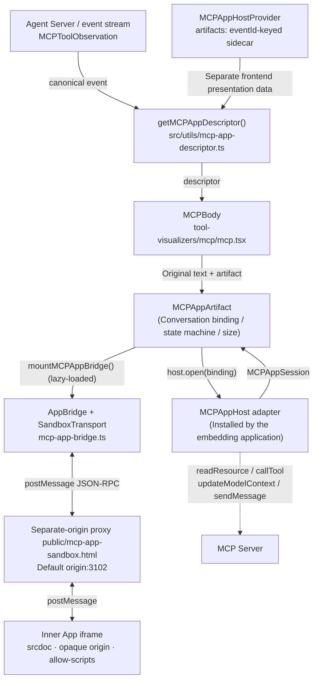

# MCP Apps in Agent Canvas

Agent Canvas acts as the **host**, rendering interactive UIs declared by an MCP
server (`ui://…`) as inline artifacts in the conversation stream. The tool's
original text result remains visible; the App enhances that existing result.

Related issue: [OpenHands/OpenHands#16620][issue].
This increment provides a **frontend integration seam and a self-contained HTML
host**. Agent Server 1.54.0 does not expose the resource/tool proxy required for
production use, so the default Canvas has **no adapter installed** and retains
its existing behavior. It adds no wire fields, Agent Server endpoint, or minimum
Server version requirement.

> See [`specs/mcp-apps.md`](../../../../specs/mcp-apps.md) for specification details
> and acceptance criteria. This document explains the architecture: layers, data
> flow, contract boundaries, security model, and local verification.

---

## 1. Data flow



The four stages are independent and can be replaced separately:

1. **Identify:** Does the Provider's separately owned sidecar declare a UI for
   this event?
2. **Retrieve:** The adapter obtains `ui://` resources and tool results from the
   correct server.
3. **Bridge:** The official `AppBridge` handles initialization and data delivery;
   see §5.
4. **Isolate:** Two iframe layers on a separate origin contain untrusted HTML;
   see §6.

---

## 2. File map

| Path                                                        | Responsibility                                                                                                                                                            |
| ----------------------------------------------------------- | ------------------------------------------------------------------------------------------------------------------------------------------------------------------------- |
| `src/types/mcp-app.ts`                                      | Public type contracts: `MCPAppIntegrationData` / `Artifacts` / `Descriptor` / `Binding` / `Scope` / `Session` / `Host` / `RequestOptions`                                 |
| `src/utils/mcp-app-descriptor.ts`                           | Validates the canonical MCP event and separate sidecar data, including `_meta.ui.resourceUri` parsing and lightweight checks; ignores unpublished App-shaped event fields |
| `src/components/features/chat/tool-visualizers/mcp/mcp.tsx` | Tool visualizer: original Markdown text plus App artifact                                                                                                                 |
| `src/components/features/mcp-apps/mcp-app-artifact.tsx`     | React host component: conversation binding, loading state machine, timeout, retry, height, and active UI locale                                                           |
| `src/components/features/mcp-apps/mcp-app-bridge.ts`        | Protocol layer: `SandboxTransport`, capability declarations, callback routing, host-context updates, and disposal                                                         |
| `src/components/features/mcp-apps/mcp-app-host-context.tsx` | `MCPAppHostProvider` / `useMCPAppHost`: explicit injection point for the host, scope, and separate artifacts map                                                          |
| `public/mcp-app-sandbox.html`                               | Static, credential-free proxy on a separate origin; forwards messages and injects `srcdoc`                                                                                |
| `scripts/mcp-app-sandbox.mjs`                               | HTTP service for the proxy page: CSP / frame-ancestors / no-store / no-referrer                                                                                           |
| `scripts/mcp-app-demo.mjs`                                  | Starts the local prototype: Vite app on port 3101 and sandbox on port 3102                                                                                                |
| `src/fixtures/mcp-apps/`                                    | Demo harness using the real renderer and protocol bridge with an in-memory Host adapter and localized sample App                                                          |
| `tests/e2e/mcp-apps/host.spec.ts`                           | Chromium end-to-end coverage: real iframe layers, callback routing, unauthorized-write rejection, and locale changes                                                      |
| `playwright.mcp-apps.config.ts`                             | Dedicated E2E configuration that starts the demo server automatically                                                                                                     |

Integration changes relative to the main branch:

| File                                       | Change                                                                                                                                           |
| ------------------------------------------ | ------------------------------------------------------------------------------------------------------------------------------------------------ |
| `tool-visualizers/dispatcher.tsx`          | Renders a dedicated `MCPBody` when an explicit sidecar descriptor is provided; otherwise `MCPToolObservation` retains its original Markdown path |
| `conversation-events/chat/messages.tsx`    | Reads the Provider sidecar and recomputes grouping when it changes, preserving the canonical event array                                         |
| `conversation-events/chat/group-events.ts` | Excludes App results from collapsed tool groups; extracts thought cards before deciding whether to group an event (§4)                           |
| `.../generic-event-message-wrapper.tsx`    | Initially expands cards containing an App                                                                                                        |
| `routes/shared-conversation.tsx`           | Forces `host={null} scope={null}` on public shared views                                                                                         |
| `components/conversation/index.ts`         | Exports the Provider and types for embedding applications                                                                                        |
| `vite.config.ts`                           | Keeps `@modelcontextprotocol/ext-apps/app-bridge` in a separate chunk                                                                            |
| `src/i18n/translation.json`                | Host title/loading/error/unavailable copy, demo UI, and sample-App copy for all 16 supported locales                                             |

---

## 3. Contract: separately owned frontend sidecar

```ts
const artifacts: MCPAppArtifacts = new Map([
  [event.id, {
    tool: { name, _meta },
    toolInput,
    toolResult,
  }],
]);
<MCPAppHostProvider host={host} scope={scope} artifacts={artifacts}>
  {conversation}
</MCPAppHostProvider>
```

**No fields are added to canonical events.** A trusted embedding adapter or
fixture is the sole owner of the sidecar and looks up separate
`MCPAppIntegrationData` by event ID. Replace the map on updates so React can
respond to data arrival or removal. The standard event stream, history,
LLM-ready observation, and transcript export do not carry private App results.
The Provider defaults to an empty map, and nested Providers do not inherit an
outer sidecar. A future production adapter must populate this view model through
published SDK/client contracts.

Parsing rules in `getMCPAppDescriptor`:

- Accept only events with `source === "environment"` and
  `observation.kind === "MCPToolObservation"`.
- `tool._meta.ui.resourceUri` is the standard entry point.
- The deprecated `tool._meta["ui/resourceUri"]` is a fallback only when no nested
  declaration exists.
- An invalid nested declaration does **not** fall back to the legacy key, which
  could silently load a different App from the server's current declaration.
- The URI must match `^ui:\/\/\S+$`, and `toolResult` must pass lightweight
  structural checks. Full schema validation runs later in the lazy-loaded
  protocol layer to keep ordinary message rendering lightweight.

If any condition fails, the function returns `null` and callers retain the
existing text renderer.

## 4. Contract: rendering and grouping

- **MCA-001:** Only explicit integration data enables an App. For an
  `MCPToolObservation` without a descriptor, `dispatcher` returns `null` and
  falls back to the existing Markdown path. The complete result remains
  available to the View.
- **MCA-002:** App results stay outside collapsed tool groups
  (`isGroupableEvent` returns `false`), and their cards initially expand.
- Original text and the artifact both belong to `MCPBody`. `MCPAppArtifact`
  does not own the original text, which remains visible while the App is
  loading, unavailable, or failed.
- `group-events.ts` extracts thought cards before its grouping decision. When an
  App interrupts a run, `flushRun()` must also emit the associated thought cards
  first, so that thought content does not disappear into the collapsed group.

## 5. Contract: Host and Session

```ts
interface MCPAppHost {
  sandboxUrl: string; // Separate HTTP(S) origin; must differ from the Canvas origin.
  open(binding, { signal }): Promise<MCPAppSession>;
}

interface MCPAppSession {
  readResource(uri, options): Promise<ReadResourceResult>; // Required.
  callTool?(params, options): Promise<CallToolResult>;
  updateModelContext?(params, options): Promise<EmptyResult>;
  sendMessage?(params, options): Promise<McpUiMessageResult>;
  dispose?(): void | Promise<void>;
}
```

- **Explicit Provider injection:** `MCPAppHostProvider` accepts `host`, `scope`,
  and a separate `artifacts` map. Its default context has an empty sidecar and
  null host/scope. Valid sidecar data without a host displays an unavailable
  message.
- **Capabilities match callbacks:** `serverResources` is always declared.
  `serverTools`, `message`, and `updateModelContext` are declared only when
  their callbacks exist. Unsupported methods are rejected with
  `MethodNotFound` in the protocol layer.
- **Content limits:** This increment supports text only. `ui/message` and
  `ui/update-model-context` reject non-text content or `structuredContent` with
  `InvalidParams`.
- **Resource limits:** Resources must have
  `mimeType === "text/html;profile=mcp-app"` and empty `_meta.ui.csp` and
  `_meta.ui.permissions`. External domains and additional permissions are not
  permitted. Blob content is decoded strictly as UTF-8.
- **Credential isolation:** Adapters own authentication, tool visibility,
  audit, and consumption of context on the next turn. Credentials and runtime
  URLs must never enter the sandbox initialization payload.
- **Published APIs first:** Once real Agent Server support exists, adapters
  must use published typed APIs to populate the separate view model. Canvas
  does not extend wire events itself.

## 6. Contract: sandbox and security model (MCA-003)

Both iframe layers have origins different from Canvas:

| Layer       | Sandbox                                      | Origin                                    | Purpose                                                          |
| ----------- | -------------------------------------------- | ----------------------------------------- | ---------------------------------------------------------------- |
| Outer proxy | `allow-scripts allow-same-origin`            | Separate origin, default `127.0.0.1:3102` | Fixed static page with no credentials; forwards messages only    |
| Inner App   | `allow-scripts`, without `allow-same-origin` | Opaque (`null`)                           | Injected through `srcdoc`; cannot access cookies or localStorage |

Mechanisms:

- **Fixed proxy document:** `scripts/mcp-app-sandbox.mjs` returns content only
  for `GET /sandbox.html` when the `parentOrigin` parameter matches its configured
  parent. Other requests return 404. Headers enforce `no-store`, `nosniff`,
  `no-referrer`, disabled `Permissions-Policy`, `frame-ancestors <parent>`, and
  a CSP based on `default-src 'none'`. Only inline scripts/styles and
  data:/blob: media are permitted.
- **Inert HTML injection:** The proxy parses App HTML with `DOMParser` in an
  inert document, adds a stricter inner CSP including `connect-src 'none'` and
  `frame-src 'none'`, then assigns it to `srcdoc`. Untrusted elements never enter
  the proxy page's DOM.
- **Source checks in both directions:**
  - The proxy accepts parent messages only when
    `event.source === parent && event.origin === parentOrigin`, and App messages
    only from the inner iframe window with `event.origin === "null"`.
  - Canvas's `SandboxTransport` checks both
    `event.source === iframe.contentWindow` and
    `event.origin === sandbox.origin`, then parses the payload with
    `JSONRPCMessageSchema`.
  - `mountMCPAppBridge` also requires an HTTP(S) sandbox URL on a different
    origin, without username/password credentials. A proxy hosted on the Canvas
    origin is rejected.
- **Messages from unauthorized windows are ignored:** JSON-RPC from the wrong
  window is silently discarded and produces no Host callback log.

> These mechanisms do not establish user authorization. The prototype starts
> valid artifacts without a consent prompt. Before enabling tool, message, or
> context callbacks, a production Host must add visibility, confirmation, audit,
> and rate-limit policies. Scope validation prevents retargeting to another
> conversation; it does not represent user consent.

## 7. Contract: conversation binding and lifecycle (MCA-004)

`MCPAppBinding` records source identity: `backendId`, `orgId`,
`connectionRevision`, `ownerConversationId`, `eventId`, `actionId`, `toolCallId`,
`toolName`, and `resourceUri`.

- **Owner resolution:** Planning events use `scope.planningConversationId`;
  other events use `scope.conversationId`. `isWritable()` requires the current
  host reference, backend, organization, revision, `readOnly` state, and
  `writableConversationId === owner` to match. Mode changes revoke write access
  without retargeting the View. An open session is never redirected to the new
  conversation.
- **Reject invalidated work:** `invoke()` combines the session signal, bridge
  lifetime signal, and request signal into one `AbortSignal`, and checks
  authorization before and after each call. Uninitialized, disposed, or aborted
  requests throw `RequestError` / `InvalidRequest`. Callback exceptions other
  than `McpError` become `InternalError`, keeping internal error details private.
- **Deterministic disposal:** Abort, retry, and component unmount remove
  listeners and dispose the bridge and transport. An initialized App first
  attempts `ui/resource-teardown` with a one-second timeout; an uninitialized
  App is cleaned up directly. Crashed or unresponsive Apps must also release
  their transports.
- **Loading state machine:** `loading → ready | error`, with a 30-second timeout.
  Failure removes the iframe's `src` and displays a retry button; retry creates
  a new binding. Iframe height starts at 360px. Runtime `sizechange` notifications
  drive height updates, clamped to `[160, 1200]` by the component and separately
  capped at 4096 by the protocol layer.
- **Shared-view override:** `routes/shared-conversation.tsx` wraps `Messages`
  with `host={null} scope={null}`, so public history pages cannot inherit the
  embedding application's live host.

## 8. Locale adaptation (MCA-005)

Host presentation uses Canvas's existing `openhands` translation namespace and
supports all 16 entries in `AvailableLanguages`: `en`, `ja`, `zh-CN`, `zh-TW`,
`ko-KR`, `no`, `ar`, `de`, `fr`, `it`, `pt`, `es`, `ca`, `tr`, `uk`, and `id`.
The catalog includes Host loading/error/unavailable copy, demo controls and
fixture text, and the sample App's labels, accessibility descriptions, status
messages, and model-context/message payloads.

`MCPAppArtifact` reads the active i18n instance's `resolvedLanguage`, falling back
to its language and then English. Initialization passes that value in
`hostContext.locale`. Later language changes call the mounted bridge's
`updateLocale`; the official `AppBridge.setHostContext()` sends a
`ui/notifications/host-context-changed` notification while preserving the other
host-context fields. The existing session, iframe, tool inputs, and private
results remain intact. A locale change does not fetch the resource again or
reopen the session. Changes during a pending resource read or bridge connection
use the latest committed locale.

The review fixture defaults to English. Choose a language from its Language
selector or open a URL such as
`http://127.0.0.1:3101/src/fixtures/mcp-apps/?lang=zh-CN`. Any supported code can
replace `zh-CN`; an unsupported query value falls back to English. The selector
updates the existing app without navigation.

Apps own localization of their content. The self-contained sample App receives
its translation catalog as inert JSON, renders translated text and attributes,
and responds to initialization and subsequent host-context notifications. It
sets `lang` and uses right-to-left direction for Arabic, while keeping tool data
and current operation status. Third-party Apps must implement their own locale
handling. Real server tool results remain verbatim; Canvas does not translate
their content. Product names, protocol methods, tool identifiers, and diagnostic
log identifiers retain their technical spelling.

Source documentation, commit messages, and PR descriptions for this contribution
use English by default, independently of the UI language selected by a user.

## 9. Packaging and performance

- The protocol SDK is lazy-loaded through `await import("./mcp-app-bridge")`
  only when a tool result has a valid descriptor and a host is available.
  Ordinary conversation startup does not load this bridge.
- `vite.config.ts` includes `@modelcontextprotocol/ext-apps/app-bridge` in
  development `optimizeDeps.include` to prevent first-load dependency
  optimization errors. Dynamic imports split the production bridge chunk.
  `resourceHTML` and `JSONRPCMessageSchema` validation run after lazy loading.
- Exact-pinned dependencies: `@modelcontextprotocol/ext-apps@1.7.5`,
  `@modelcontextprotocol/sdk@1.29.0`, and `zod@4.4.3`.

## 10. Local verification

```bash
# Prototype: real renderer and protocol bridge, in-memory Host adapter.
# No Agent Server or LLM connection.
npm run demo:mcp-apps
# Open http://127.0.0.1:3101/src/fixtures/mcp-apps/
# The sandbox also starts at http://127.0.0.1:3102/sandbox.html.
# Use the Language selector or add ?lang=ja to review another locale.

# End-to-end tests: Chromium, with the demo server started automatically.
npm run test:e2e:mcp-apps
# MCP_APPS_BROWSER_PATH selects an installed browser.
# MCP_APPS_SCREENSHOT_PATH exports an App screenshot.

# Unit tests.
npm test -- mcp-app

# After editing translation.json, regenerate and validate locale bundles.
npm run make-i18n
npm run check-translation-completeness
```

Run the sandbox service separately when needed. Remote/HTTPS deployments must
use a dedicated HTTPS origin and retain the response headers enforced by the
script:

```bash
node scripts/mcp-app-sandbox.mjs --parent-origin http://127.0.0.1:3101
```

The script first reads `public/mcp-app-sandbox.html` in a source checkout, then
falls back to the fixed `build/mcp-app-sandbox.html` path in an npm package
layout. The required HTML is shipped with the static build.

The prototype covers original-text preservation, delivery of the complete
`toolResult` including View-only `_meta`, the `callServerTool`,
`updateModelContext`, and follow-up-message callbacks, source filtering, write
revocation after mode changes, and live locale updates. This does not validate
the production integration: production launchers do not automatically start
`scripts/mcp-app-sandbox.mjs`.

## 11. Spec ID to test mapping

| ID      | Behavior                                                                                                  | Main tests                                                                                                                                                       |
| ------- | --------------------------------------------------------------------------------------------------------- | ---------------------------------------------------------------------------------------------------------------------------------------------------------------- |
| MCA-001 | Explicit integration data enables Apps; other results keep their text                                     | `__tests__/components/features/chat/tool-visualizers/mcp/mcp.test.tsx`, `src/utils/mcp-app-descriptor.test.ts`                                                   |
| MCA-002 | App cards start expanded and stay outside collapsed groups                                                | `__tests__/components/conversation-events/chat/group-events.test.ts`                                                                                             |
| MCA-003 | Adapter resource reads, official bridge, and separate-origin proxy                                        | `__tests__/components/features/mcp-apps/mcp-app-bridge.test.ts`, `tests/e2e/mcp-apps/host.spec.ts`                                                               |
| MCA-004 | Conversation binding, write-access rechecks, disposal after invalidation                                  | `src/components/features/mcp-apps/mcp-app-artifact.test.tsx`, `mcp-app-host-context.test.tsx`, `__tests__/routes/shared-conversation-viewer-behavior.test.tsx`   |
| MCA-005 | All supported locales, default English, live host-context updates, Arabic RTL, and preserved session/data | `src/components/features/mcp-apps/mcp-app-artifact.test.tsx`, `__tests__/components/features/mcp-apps/mcp-app-bridge.test.ts`, `tests/e2e/mcp-apps/host.spec.ts` |

## 12. Remaining production work

1. Preserve metadata and provenance in the SDK / Agent Server.
2. Provide conversation-bound resource/tool proxies.
3. Implement tool visibility, user confirmation, audit, and rate limits.
4. Consume App context on the next turn, so `updateModelContext` reaches the
   actual model context.
5. Persist Cloud history and support ACP. Existing ACP events lack equivalent
   provenance and resource routing.
6. Supply a real Host adapter and determine sandbox deployment for each install
   mode.
7. Update `compatibility.minimumAgentServer` in `config/defaults.json` if the
   final integration requires a new Server contract.

## 13. Invariants for future changes

- Do not infer UI resources from ordinary text, `raw_output`, or arbitrary
  iframe-supplied metadata.
- Keep private App metadata out of messages sent to the LLM.
- Keep credentials and runtime URLs out of sandbox initialization payloads.
- Keep the proxy on a different origin from Canvas.
- Never add `allow-same-origin` to the inner iframe.
- Reject writes after ownership changes and never redirect an existing session
  to a new conversation.
- Prevent public shared views from inheriting a live host.
- Locale changes update presentation through the existing bridge; they do not
  recreate sessions or replace real tool data.

[issue]: https://github.com/OpenHands/OpenHands/issues/16620
